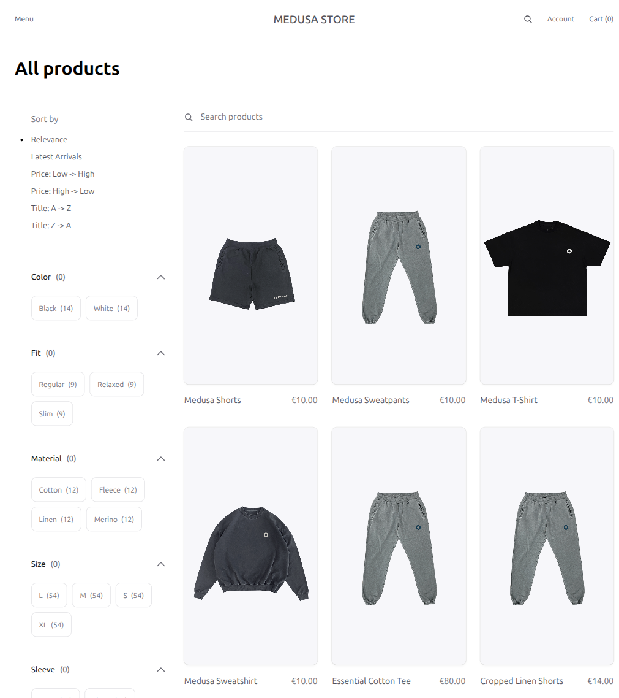

# MedusaJS 2 on Railway

**Medusa server + worker, Next.js storefront, PostgreSQL, Redis and persistent
media, wired together and verified end to end.**


[](https://railway.com/deploy/medusajs-2-full-stack-production-ready?referralCode=aceweb&utm_medium=integration&utm_source=template&utm_campaign=generic)



A fork of [`medusajs/dtc-starter`](https://github.com/medusajs/dtc-starter), the
monorepo `create-medusa-app` scaffolds today, with the infrastructure a real
deployment needs layered on top. Deploy it to Railway in one click and you get a
store that already has an admin account, regions, a sales channel, a publishable
API key, working search and a demo catalogue. Then keep developing it as a normal
Medusa project.

Published on the Railway marketplace as
[MedusaJS 2 Full Stack Production Ready](https://railway.com/deploy/medusajs-2-full-stack-production-ready?referralCode=aceweb&utm_medium=integration&utm_source=template&utm_campaign=generic).
The listing copy is mirrored in
[docs/marketplace-listing.md](docs/marketplace-listing.md).

## What is included

|                           |                                                                              |
| ------------------------- | ---------------------------------------------------------------------------- |
| Medusa 2.22               | API, admin dashboard at `/app`, store and admin REST APIs                    |
| Server and worker         | The documented production topology, same image, different mode               |
| PostgreSQL                | Provisioned by the template, over Railway's private network                  |
| Redis                     | Event bus, workflow engine, locking provider and cache                       |
| Next.js storefront        | Medusa's own DTC starter, product pages, cart, multi-step checkout           |
| Search                    | Medusa's index on PostgreSQL, with facets. No separate search service        |
| Persistent media          | Uploads go to a Railway bucket, served by a read-only proxy                  |
| Idempotent bootstrap      | Migrations, admin account and publishable key, from the container entrypoint |
| Optional Stripe, SendGrid | Configured when you set a key, absent when you do not                        |
| Smoke test                | Places a real order against a deployment, so "Online" is not the bar         |

## Why this exists

Medusa's [deployment guide](https://docs.medusajs.com/learn/deployment/general)
asks for two instances of the application, one in server mode and one in worker
mode, with Redis behind the event bus, the workflow engine, locking and the cache.
Most one-click Medusa templates run a single process and skip some of those
modules. That works until a long-running workflow starts competing with checkout
requests, or a second replica takes a lock that is only held in memory.

The other half is cold-start behaviour. A stack that works in the project you
built it in is not the same as a template that works in a stranger's empty
project, where every service builds and boots in parallel and nothing has been set
up by hand. The specific things that break, and what this does about them, are in
[docs/local-testing.md](docs/local-testing.md) and
[docs/railway-template.md](docs/railway-template.md).

## Deploy to Railway

[](https://railway.com/deploy/medusajs-2-full-stack-production-ready?referralCode=aceweb&utm_medium=integration&utm_source=template&utm_campaign=generic)

Railway creates seven resources: the Medusa server, the worker, the storefront,
the media proxy, PostgreSQL, Redis and a storage bucket. Every variable is filled
in from those, and every secret is generated at deploy time, so **there are no
variables to fill in**. The deploy form asks you for one thing, the bucket's
region, which a template is not allowed to set. The first deploy then builds the
four images, migrates, bootstraps and seeds a demo catalogue.

Verified cold on 2026-11-15: all six services green in about four minutes in our
test, and `scripts/smoke-test.mjs` passing 17/17 against the deployed URLs, order
included. Build queue time varies, so treat four minutes as the shape of it
rather than a guarantee.

### First run

1. Click **Deploy** and pick a region for the storage bucket.
2. Wait for the services to go green.
3. Open the **storefront** URL. It already has a catalogue, regions and search.
4. Open the **medusa-backend** URL at `/app` for the admin dashboard.
5. Sign in with `MEDUSA_ADMIN_EMAIL` and `MEDUSA_ADMIN_PASSWORD` from
   medusa-backend's **Variables** tab. The password was generated for you.

Copy that password somewhere before you start using the store. It is applied on
the first boot only, so changing the variable later does not reset the account.

### Deploying this repository directly

The button above deploys a published Railway template. To deploy your own copy of
this repository instead, use the Railway CLI:

```bash
npm --prefix .railway install   # the SDK that evaluates railway.ts
railway login
railway init
railway config apply            # six services and the bucket
railway domain --service medusa-backend
railway domain --service storefront
railway domain --service media-proxy
railway config apply            # again, now that the domains exist
```

Apply twice, with the domains in between: every expression built on a public
domain resolves to an empty string until that domain exists, and the storefront
bakes its backend URL and publishable key into the bundle at build time.

`.railway/railway.ts` describes the whole project, including the bucket. Applying
it owns the environment, so anything not described in it is deleted: point it at
a new project rather than one that already has other things in it. Change `REPO`
to your own fork first, or you will deploy this repository rather than yours. The
rest, including the exact variables and the template editor's quirks, is in
[docs/railway-template.md](docs/railway-template.md).

## Running it in production

**Lost the admin password.** Create a second admin from inside the running
container:

```bash
railway ssh --service medusa-backend
node_modules/.bin/medusa user -e you@example.com -p 'a-new-password'
```

`medusa user` creates an account rather than resetting one, so give it an address
that is not already registered. `railway ssh`, not `railway run`: `run` executes
on your machine with the service's variables, and `DATABASE_URL` points at
Railway's private network, which your laptop cannot reach.

The dashboard's own "forgot password" link is not a route back in. Medusa only
emits an `auth.password_reset` event and leaves sending the mail to the
application, and this template ships no subscriber for it, so setting
`SENDGRID_API_KEY` does not make that link work.

**Customising the store.** This is a normal Medusa project, not a black box. Fork
it, and work in `apps/backend/src` for the API, workflows, modules and admin
extensions, and `apps/storefront/src` for the front end. `AGENTS.md` maps every
directory to what belongs in it. Point your fork's `REPO` in
`.railway/railway.ts` at itself, or just change the service's source repository
in the Railway dashboard.

**Turning off the demo catalogue.** Set `SEED_DEMO_DATA=false` before the first
deploy for an empty store. Afterwards, delete the demo products in the admin;
they are seeded once and do not come back on redeploy.

**Backups.** Railway can take scheduled backups of the Postgres volume from the
service's Settings tab, and that covers orders, customers and products. It does
not cover the storage bucket, so uploaded media needs its own copy if you care
about it: any S3 client pointed at the `S3_` variables will do.

**Custom domains.** Add the domain in Railway, then update the variables that
embed a URL, because several are baked in rather than read at request time.
Group them by which domain changed, not by which service holds them.

A new **backend** domain: `MEDUSA_BACKEND_URL`, `ADMIN_CORS` and `AUTH_CORS` on
medusa-backend, and `NEXT_PUBLIC_MEDUSA_BACKEND_URL` on storefront.

A new **storefront** domain: `STORE_CORS` and `AUTH_CORS` on medusa-backend,
which name the storefront rather than themselves, and `NEXT_PUBLIC_BASE_URL` on
storefront.

The storefront has to rebuild for any of its own to take effect, since Next
inlines them at build time.

**Changing where media is served from.** `S3_FILE_URL` is written onto every
product image as it is uploaded, so changing it later does not rewrite rows that
already exist. Pick the public address before you build the catalogue.

**Upgrading Medusa.** `scripts/sync-upstream.sh` and a three-way merge, described
under [Keeping up with Medusa](#keeping-up-with-medusa). Migrations run from the
entrypoint on the next deploy, and medusa-worker waits for a medusa-backend
running the same build before it starts, so it never runs new code against a
schema that has not been migrated yet.

## Run it locally

```bash
docker compose --profile stack up -d --build
node scripts/smoke-test.mjs
```

That brings up the whole topology from the same three Dockerfiles Railway builds,
including the media proxy, so the failures that only happen on a cold deploy
happen here first. Details, and the scenarios worth running before touching
Railway, are in [docs/local-testing.md](docs/local-testing.md).

Admin at <http://localhost:9000/app>, storefront at <http://localhost:8000>,
`admin@example.com` / `supersecret`.

## Layout

```text
apps/backend/        Medusa, upstream, plus medusa-config.ts and src/scripts/bootstrap.ts
apps/storefront/     Next.js, upstream, plus two small production fixes
media-proxy/         read-only public reads of the bucket, outside the workspace on purpose
docker/              the three images and the backend entrypoint
scripts/             smoke test and upstream sync
.railway/railway.ts  the project, applied with the Railway CLI
docs/                local testing, Railway template, upstream sync, listing copy
```

## Keeping up with Medusa

```bash
scripts/sync-upstream.sh main
git merge upstream
```

The `upstream` branch holds a faithful snapshot of dtc-starter, and this fork's
work sits in commits on top of it, so a sync is a real three-way merge rather than
a hand diff. The files that deliberately differ, and what to expect from each, are
listed in [docs/upstream-sync.md](docs/upstream-sync.md).

Dependencies are untouched: the Redis, S3 and payment modules are reached through
`@medusajs/medusa/<module>` subpath exports rather than added to `package.json`, so
a Medusa version bump needs no changes here.

## Licence

MIT, as the upstream starter is. See [LICENSE](LICENSE).
